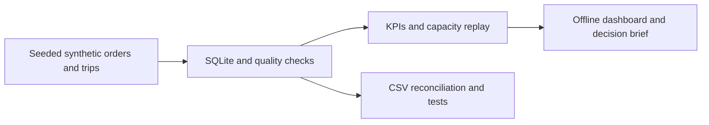

# Logistics Operations Analytics

A reproducible portfolio project for delivery performance, exception investigation and transport-capacity analysis. It combines Python, SQL/SQLite and an offline dashboard to support operational decisions.

All data are synthetic. This is an independent personal project; it uses no employer or customer data.

## Mixed-source data engineering supplement

The later [local Ollama extension](supplements/operations_ingestion/RAG_DURABLE_GUIDE.md) has owner-run synthetic Mac evidence and a durable experiment runner. Independent live runtime verification and human semantic review remain pending. The milestone descriptions below retain their historical verification scope.

[Operations ingestion and evidence review](supplements/operations_ingestion/README.md) adds CSV/JSONL/text ingestion, transactional SQLite loading, exact reconciliation and replay checks. M4 improves recent-event selection and includes an offline human-review packet plus a disposable PostgreSQL query experiment. The author supplied Mac results for 50 tests, eight authored baseline cases and the PostgreSQL benchmark, and confirmed reviewing all eight additional scenarios with no issues reported. [Case study](supplements/operations_ingestion/CASE_STUDY.md) | [Data model](supplements/operations_ingestion/DATA_MODEL.md) | [Evidence summary](supplements/operations_ingestion/AUTHOR_VERIFICATION_M4.json). At the M4 milestone, model execution was unverified and paused; orchestration is custom Python, not Airflow. CI independently checks Python 3.10/3.13 and PostgreSQL without API keys.

The [PostgreSQL operations pipeline](supplements/operations_ingestion/POSTGRES_GUIDE.md) extends that contract to typed PostgreSQL storage, transactional loading, exact source reconciliation and repeated reporting. Sixteen real integration tests passed in CI on Python 3.10/3.13 and on the author's Mac. [Mac evidence](supplements/operations_ingestion/AUTHOR_VERIFICATION_M5.json).

## Portfolio at a glance

**Question:** Should an operations team investigate delivery exceptions or add transport capacity first?

**Evidence:** 1,339 synthetic orders, 168 trips, 3 warehouses, 2 route groups. SQLite aggregates are independently checked against CSV; 14 Python tests include hand-calculated examples. JavaScript filters preserve KPI denominators.

**Finding for seed 42:** DC-B / Outer is the service-investigation priority. DC-C / Outer has the highest modeled shortage recovery per added capacity unit at +10%. These are different decisions; neither proves a real root cause or an operational benefit.

**Read first:** [Decision brief](output/decision_brief.md) · [Metric contract](#metric-contract) · [Presentation guide (Thai)](docs/guides/PRESENTATION_GUIDE_TH.md)

Download/clone the repository and open `output/dashboard.html` locally. GitHub file preview shows HTML source, not a live hosted app. No server, dependencies or login are required for the offline dashboard.



### Verification status

- Local build: passed in the development environment.
- Mac author trial: milestones 1–4 passed on Python 3.10; later terminal checks were reported by the owner; this does not constitute automated browser verification.
- GitHub CI verified: [run 39544750271](https://github.com/Quetzel6/logistics-operations-analytics/actions/runs/39544750271) passed on Python 3.10 and 3.13 at commit `65c2d8d06b023ad86ebbd4928955eb065f3dff79`, including Python validation, JavaScript filtering and evidence upload. Later commits require their own CI result.
- Browser visual/interaction automation: not completed because browser executable was unavailable.

## Start (Mac / Python 3.10+)

No pip installation or server required. From this extracted project folder:

```bash
python3 -m unittest discover -s tests -q
python3 project.py
open output/dashboard.html
```

A pre-generated `output/dashboard.html` is included so it can also be opened directly. Rerunning replaces only this project's generated output database/reports. Do not point `--output` at a folder holding another logistics.sqlite database.

## Business question

Which warehouse/route needs investigation first, is the issue delivery service or available dispatch capacity, and how does the review workload change under different OTIF targets?

## Current scope — portfolio handoff, 19 October 2026

- Reproducible synthetic orders and trips over a 28-day dispatch window; three DCs, two route groups.
- SQLite source tables, SQL aggregation, foreign-key and capacity/date checks.
- On-time delivery, OTIF, unit fill, overdue open orders and trip capacity utilization.
- Warehouse/route report and threshold sensitivity at 80/85/90/95% OTIF.
- CSV exports, JSON evidence, SQLite database and offline HTML dashboard.
- Fourteen automated Python tests, including hand-calculated denominator and capacity checks.

This is a working prototype, not a completed operational platform. It does not yet include Power BI, demand forecasting, live OMS integration, staffing models, cost optimization or a deployment.

## Metric contract

| Metric | Formula / denominator |
|---|---|
| Due orders | Due date on or before 2026-10-19 |
| On-time rate | Delivered by due date / all due orders, including overdue undelivered |
| OTIF | Delivered by due date AND shipped units equal ordered units / all due orders |
| Unit fill | Shipped units / ordered units, for due orders |
| Overdue open | Due orders without recorded delivery |
| Trip utilization | Total shipped homogeneous capacity units / capacity summed once per dispatched trip |

Utilization covers dispatched trips while delivery KPIs cover due orders. Their windows deliberately differ; do not directly equate them. A due-today undelivered order is considered overdue at the **end-of-day snapshot** used here. Shipped quantity is used as the in-full proxy; no independent recipient acceptance events exist.

## Evidence and interpretation

`project.py` generates data with a fixed seed and **deliberately increases dispatch exceptions at DC-B / Outer**. The dashboard is expected to recover this pattern. It is not an independent validation dataset, a causal finding or a demonstrated business improvement.

The sensitivity table changes the alert threshold only. It does not claim a forecast or quantify the effect of adding vehicles. Costs, vehicle dimensions, labor and actual inventory are absent; adding more vehicles cannot be recommended from this dataset alone.

## Remaining validation and extensions

1. Validate the metric contract and recommendations against independent operational data before any business use.
2. Review the implemented exception drill-down and daily trends using the same source tables.
3. Review the implemented capacity replay and stress scenarios; independent-period validation remains future work.
4. Build a Power BI report if the local environment supports authoring; otherwise retain the working HTML and SQL evidence and do not claim Power BI implementation.
5. Clean isolated builds and CSV/SQL reconciliation passed locally and in GitHub CI. Complete browser review and recruiter screenshots before publishing visual evidence.

## Milestone 2: exception drill-down and daily service

Warehouse/route filters apply to the daily table and exception worklist only. The exception-type filter affects the worklist only; it never removes successful orders from a KPI denominator. Network cards above remain fixed and are explicitly labeled. One order may have multiple flags but appears once in the worklist.

Daily metrics are grouped by promised date and evaluated at the end-of-day as-of snapshot. They are **not** historical daily snapshots. Deliveries after the snapshot count as open. Review `output/exceptions.csv` and `output/daily.csv` for portable evidence.

Optional JavaScript logic check (requires Node, not needed to open the dashboard):

```bash
node tests/test_dashboard.cjs
```

## Milestone 3: capacity scenarios

Compare 0/10/20% capacity increments on unchanged assigned trips, both network-wide and by DC/route. All capacity is measured in homogeneous units, not number of vehicles. Recoverable units are a **static upper bound**, assuming stock, labor, loading and receiving constraints do not bind. This is a hypothetical pre-dispatch replay; it cannot undo historical shipments.

- Due shortages = ordered minus shipped for orders due by the snapshot.
- Spare room = increased trip capacity minus ALL loaded units, including future-due orders on that trip.
- Recoverable upper bound = sum of min(due shortage, spare room), evaluated per trip; no pooling.
- Incremental recoverable = scenario upper bound minus baseline upper bound.
- Unused added capacity = added capacity minus incremental recoverable; this labels capacity unused for the modeled shortage recovery only.
- Stress demand = (loaded units + due shortages) scaled by 0/10/20%, rounded down per trip. This excludes future-due shortages, is not a forecast and assumes the same trip assignments.

No costs or changes to delivery time/OTIF are inferred. New evidence is exported as capacity_scenarios.csv and capacity_stress.csv. Five additional hand-calculated scenario tests cover pooling, bounds, stress arithmetic, future-due exclusions and targeted scope.

## Milestone 4: decision brief and release evidence

`output/decision_brief.md` separates service reliability investigation from the capacity replay candidate. Priority selection is retrospective on the same synthetic data, not validation of a general policy. The dashboard embeds the key conclusions so the brief need not be opened to understand them.

```bash
python3 verify_release.py
```

This runs 14 Python tests, builds twice into isolated temp directories, compares generated artifact bytes, independently recalculates due/on-time/OTIF counts from raw CSV and checks scenario scope sums. It writes output/release_verification.json with artifact SHA-256 digests. It does not verify browser appearance, Python on every operating system or operational effectiveness. JavaScript filtering is checked separately with `node tests/test_dashboard.cjs` when Node is available.

Do not claim production deployment or employer adoption. All data and the dispatch delay pattern are synthetic. The scope is a synthetic portfolio prototype; no operational rollout is claimed.

## Milestone 5: presentation and understanding

Dashboard tabs: Overview / Exceptions / Scenarios / Definitions. Overview adds a common-scale 0–100% OTIF bar comparison. Exceptions adds a daily OTIF line chart that uses warehouse/route filters while retaining all selected due orders in the denominator. Exact tables remain available; charts do not change KPI calculations. No CDN or server is required.

Read docs/guides/PRESENTATION_GUIDE_TH.md for a 3–5 minute walkthrough, code map and eight understanding exercises. This release passed Python/reproducibility checks and JS filter/syntax checks. Automated browser visual/interaction verification could not run in the build environment because the browser binary was unavailable; verify appearance and tabs on the author's Mac before recruiter screenshots.
